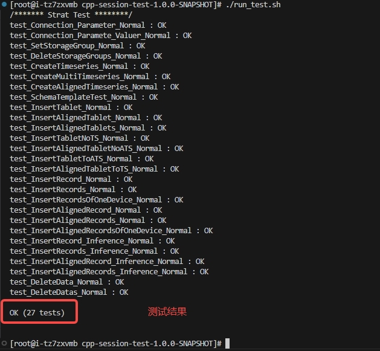
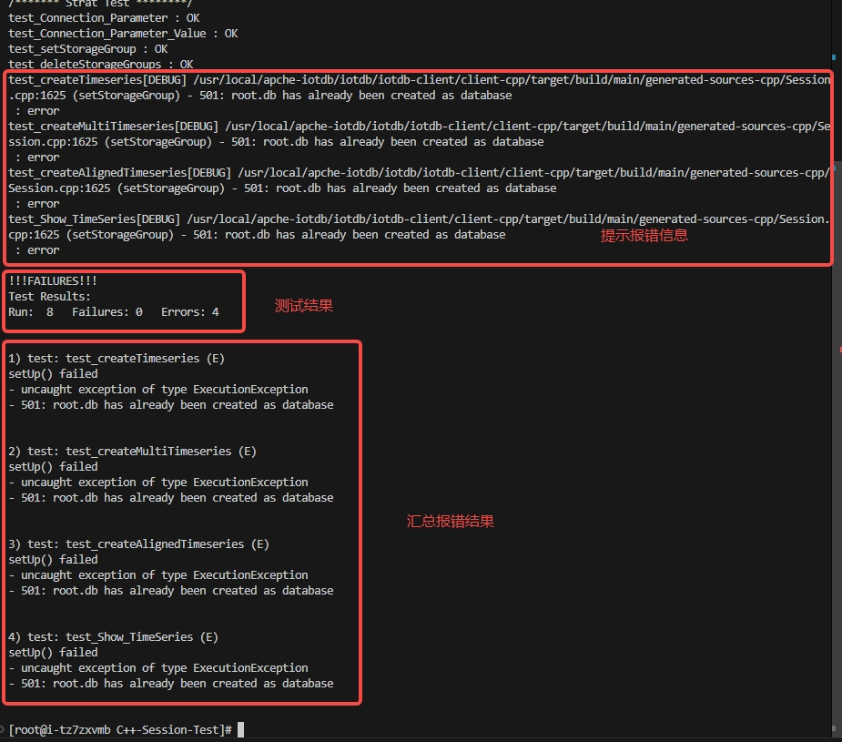

# Cpp-Session-Test说明

-----

## 一、介绍

本程序是基于开源版IoTDB C++客户端API进行测试的程序

### 1、目录

```txt
├── assert                      // 静态资源目录
├── build                       // 编译和生成可执行文件目录
├── client                      // 头文件和库文件目录
├── data                        // 测试数据目录
|   ├── table                   // 表模型测试数据目录
|   ├── tree                    // 树模型测试数据目录
├── test                        // 测试代码目录
|   ├── table                   // 表模型测试用例目录
|   ├── tree                    // 树模型测试用例目录
|   ├── CMakeLists.txt          // 测试代码目录的配置文件
|   ├── main.cpp                // 测试程序入口文件
├── CMakeLists.txt              // 主配置文件
├── CMakePresets.json           // CMake项目构建配置文件
├── compile.sh                  // 编译脚本
├── README.md                   // 程序说明文档
├── run.sh                      // 执行脚本
```

### 2、编译

拉取iotdb源码并编译生成c++头文件和库文件

```bash
# 拉取
git clone https://github.com/apache/iotdb.git
cd iotdb
./mvnw clean package -pl example/client-cpp-example -am -DskipTests -P with-cpp
# 存放头文件和库文件
头文件位于：iotdb-client/client-cpp/target/client-cpp-*-SNAPSHOT-cpp-linux-x86_64/include下，存放到测试程序根目录的client/include下
库文件位于：iotdb-client/client-cpp/target/client-cpp-*-SNAPSHOT-cpp-linux-x86_64/lib下，存放到测试程序根目录的client/lib下
```

第一次需要手动编译gtest测试工具生成gtest头文件和库文件，也需要存放到同样地方下

---

## 二、使用

在根目录下执行命令

```bash
# 编译
./compile.sh
# 执行
./run.sh
```

成功结果如下图所示



出现错误结果如下图所示




## PLM 接入（start.sh）

仓库根目录的 `start.sh` 是 TimechoPLM 测试程序统一入口：

```bash
sh start.sh prepare                 # 编译测试程序（需先准备 client/include、client/lib）
sh start.sh list-cases --json       # 用例清单（stdout 仅 JSON）
sh start.sh case <CASE_ID>          # 单条用例，产物写 $PLM_REPORT_DIR
```

- `PLM_AUTOMATION_TYPE`：默认 `session-cpp`。
- `PLM_REPORT_DIR`：JUnit XML 输出目录（相对仓库根，默认 `reports/`）。
- `IOTDB_HOST` / `IOTDB_PORT`：PLM 执行时由平台按 `k8sInstanceId` 注入；缺少任一项时 `case` 直接失败，不会回退默认地址。
- `IOTDB_USER` / `IOTDB_PASSWORD`：可选覆盖，默认 `root/TimechoDB@2021`。
- 运行前置：`client/include` 与 `client/lib` 下需有 TimechoDB C++ SDK（`libiotdb_session.so`），以及 gtest 头文件/库；`compile.sh` 会构建 `build/test/main`。
